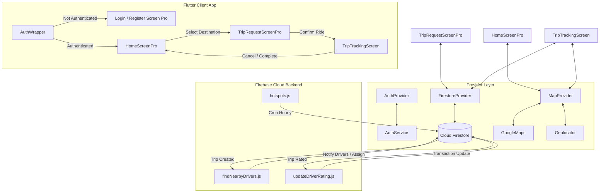

# Rider Taxi App (Ismail Taxi) - Comprehensive Technical Specification & AI Agent Reference

This document serves as the complete technical architecture reference and onboarding blueprint for AI agents and human developers continuing the development of the **Rider Taxi Application**.

---

## 1. Executive Summary & Product Vision

The **Rider Taxi App** is a full-featured, cross-platform mobile ride-hailing application built with **Flutter** and powered by a serverless **Firebase** backend. The system supports real-time ride requests, intelligent driver dispatching, live trip tracking, dynamic fare calculations, automated hotspot analysis, and driver rating management.

### Key Capabilities
* **User & Authentication Management**: Email/password authentication with automatic Firestore role profiling (Rider vs Driver).
* **Location & Geospatial Engine**: Multi-layered fallback location tracking (GPS -> Last Known -> Cached -> Default fallback) with timeout protection.
* **Map & Route Visualization**: Custom Google Maps integration with route polylines, animated markers, address geocoding, and custom animations.
* **Ride Booking & Fare Engine**: Multi-tier vehicle selection (Standard, XL, VIP), multi-stop routing with waiting time support, and dynamic fare estimation based on base fare, distance, duration, and vehicle multiplier.
* **Smart Driver Dispatching (Cloud Functions)**: Multi-factor scoring algorithm (Distance, Tier, Acceptance Rate, User Rating) for driver matching.
* **Automated Demand Hotspots**: Hourly scheduled Cloud Function for 30-day spatial grid-clustering of completed pickup locations.
* **Rating & Feedback System**: Transactional moving average updates for driver ratings triggered automatically upon trip completion.

---

## 2. Technology Stack & Dependencies

| Component | Technology / Package | Purpose |
| :--- | :--- | :--- |
| **Frontend Framework** | Flutter `^3.7.2` / Dart | Cross-platform mobile UI (iOS / Android / Web) |
| **State Management** | `provider: ^6.1.1` | Reactive state management (`AuthProvider`, `MapProvider`, `FirestoreProvider`) |
| **Authentication** | `firebase_auth: ^5.3.1` | Identity management & session management |
| **Database** | `cloud_firestore: ^5.4.4` | Real-time NoSQL database for users, trips, drivers, payments |
| **Cloud Backend** | Firebase Cloud Functions Node.js (v2 API) | Serverless backend logic (Dispatching, Hotspots, Rating calculations) |
| **Maps & Geospatial** | `google_maps_flutter: ^2.5.0` | Vector maps, custom markers, polyline overlays |
| **Location Services** | `geolocator: ^10.1.0` | High-precision device GPS location querying and permission handling |
| **Routing & Geocoding**| `flutter_polyline_points: ^2.0.0`, `geocoding: ^2.1.1` | Directions API polylines and reverse geocoding |
| **Utilities** | `http: ^1.1.0`, `intl: ^0.19.0`, `shared_preferences: ^2.1.0` | REST API requests, date/number formatting, local key-value caching |

---

## 3. Repository & Directory Structure

```
taxi_auth_app/
├── android/                         # Android native platform configuration & manifests
├── ios/                             # iOS native platform configuration & Info.plist
├── lib/                             # Core Flutter Application Code
│   ├── main.dart                    # Application entry point, Provider wiring, Theme setup
│   ├── firebase_options.dart        # Auto-generated Firebase platform credentials
│   ├── models/                      # Immutable Data Models
│   │   ├── location_model.dart      # Geo-coordinates, address name, placeId wrapper
│   │   └── user_model.dart          # Firebase user model mapper
│   ├── providers/                   # Reactive State Controllers (ChangeNotifier)
│   │   ├── auth_provider.dart       # Authentication workflow state
│   │   ├── firestore_provider.dart  # Database CRUD, trip lifecycle, payment & ratings logic
│   │   └── map_provider.dart        # Map camera control, routing, fare math, location init
│   ├── screens/                     # Application Screen Views
│   │   ├── auth_wrapper.dart        # Reactive root view routing based on Auth status
│   │   ├── login_screen.dart        # Standard Login view
│   │   ├── login_screen_pro.dart    # Modern dark glassmorphic Login view
│   │   ├── register_screen.dart     # Standard Registration view
│   │   ├── register_screen_pro.dart # Modern dark glassmorphic Registration view
│   │   ├── home_screen.dart         # Legacy home view
│   │   ├── home_screen_pro.dart     # Main interactive map home UI (Search bar, quick destinations)
│   │   ├── trip_request_screen.dart # Legacy trip request UI
│   │   ├── trip_request_screen_pro.dart # Ride customization (Vehicle selector, multi-stop, fare summary)
│   │   ├── trip_tracking_screen.dart # Active trip live tracking screen with animated road widget
│   │   ├── trip_history_screen.dart # Legacy trip history view
│   │   ├── trip_history_screen_pro.dart # Searchable & filterable trip history with detailed modal
│   │   ├── forgot_password_screen.dart  # Password reset view
│   │   └── settings_screen.dart     # User profile management, dark mode toggle, favorite locations
│   ├── services/                    # Lower-level Service Wrappers
│   │   ├── auth_service.dart        # Direct FirebaseAuth wrapper
│   │   └── location_service.dart    # Stream/Position location helper
│   ├── utils/                       # Utility Functions & Configuration
│   │   └── emulator_config.dart     # Local Firebase Emulator connection helper
│   └── widgets/                     # Custom Reusable UI Components
│       ├── animated_taxi_road.dart  # Dynamic CustomPainter animated road graphic for search state
│       ├── auth_wrapper.dart        # Auth state listener and screen switcher
│       ├── location_input.dart      # Auto-complete location text field input
│       └── map_widget.dart          # Embedded GoogleMap widget wrapper
├── functions/                       # Firebase Cloud Functions (Node.js)
│   ├── index.js                     # Functions exporter
│   ├── adminConfig.js               # Shared Firebase Admin SDK initialization
│   ├── findNearbyDrivers.js         # Document trigger (trip creation) -> Driver priority matching
│   ├── hotspots.js                  # Cron scheduler -> 30-day spatial grid clustering
│   └── updateDriverRating.js        # Document trigger (trip rating update) -> Transactional driver rating recalculation
├── firestore.rules                  # Security rules for collections (users, drivers, trips, payments, vehicles)
├── firestore.indexes.json           # Required composite indexes for queries
├── location_handling_strategy.md.resolved # Reference strategy for reliable GPS location handling
└── pubspec.yaml                     # Package dependencies and asset manifests
```

---

## 4. Architectural Overview & System Flow



---

## 5. Key System Features & Implementation Details

### A. Location Handling & Geospatial Resilience Strategy
Implemented in `lib/providers/map_provider.dart` following guidelines in `location_handling_strategy.md.resolved`:
1. **Service & Permission Checks**: Validates system location status and requests permission (`LocationPermission.denied`, `deniedForever`).
2. **Timeout Protection**: Queries GPS with a strict 10-second timeout.
3. **Fallback Escalation**: If timeout/error occurs, attempts `Geolocator.getLastKnownPosition()`.
4. **Safe Default**: If all fail, defaults to predefined coordinates (Beirut `33.8938, 35.5018` or configured city center).
5. **Post-Frame Guard**: Uses `SchedulerBinding.instance.addPostFrameCallback` to prevent setState/notifyListeners calls during widget tree building.

### B. Dynamic Fare & Vehicle Pricing Calculation
Located in `lib/providers/map_provider.dart` (`calculateFare` method):
* **Formula**:
  $$\text{Fare} = (\text{Base Fare} + (\text{Distance km} \times \text{Per KM Rate}) + (\text{Duration min} \times \text{Per Min Rate})) \times \text{Vehicle Multiplier} + \sum \text{Stop Waiting Fees}$$
* **Vehicle Tiers**:
  * **Standard Taxi**: Multiplier $1.0\times$
  * **XL Taxi (SUV/Van)**: Multiplier $1.4\times$
  * **VIP Premium**: Multiplier $2.0\times$

### C. Smart Driver Dispatching Algorithm (Cloud Functions)
Located in `functions/findNearbyDrivers.js` triggered when a trip document is created with status `searching`:
* Calculates distance using the Haversine formula.
* Scores candidate drivers (0 to 100 points):
  1. **Distance Score (0-50 pts)**: $50 - (\text{Distance in km} \times 5)$.
  2. **Tier Bonus (0-15 pts)**: Platinum (15), Gold (10), Silver (5), Bronze (0).
  3. **Acceptance Rate (0-20 pts)**: $(\text{AcceptanceRate \%} / 100) \times 20$.
  4. **Rating Score (0-15 pts)**: $(\text{UserRating} / 5) \times 15$.
* Ranks top drivers and dispatches push notifications via FCM.

### D. Automated Hotspot Analysis (Cloud Functions)
Located in `functions/hotspots.js`:
* Scheduled to run every hour (`onSchedule("every 1 hours")`).
* Fetches completed trips created in the last 30 days.
* Clusters pickup coordinates using a $0.01^\circ \approx 1\text{ km}$ spatial grid.
* Overwrites `hotspots` collection in Firestore with cluster centers and demand metrics.

### E. Transactional Driver Rating (Cloud Functions)
Located in `functions/updateDriverRating.js`:
* Triggers when `trips/{tripId}` is updated with a `userRating`.
* Uses `db.runTransaction` to prevent race conditions.
* Computes new cumulative moving average:
  $$\text{New Rating} = \frac{(\text{Current Rating} \times \text{Rating Count}) + \text{New Rating}}{\text{Rating Count} + 1}$$

---

## 6. Database Schema Specifications (Firestore)

### 1. `users` Collection
```json
{
  "uid": "STRING (Doc ID)",
  "email": "STRING",
  "displayName": "STRING",
  "phoneNumber": "STRING",
  "photoURL": "STRING",
  "favoriteLocations": [
    {
      "name": "Home",
      "address": "123 Main St",
      "latitude": 37.4042,
      "longitude": -122.0852
    }
  ],
  "paymentMethods": [],
  "rating": 5.0,
  "tripCount": 12,
  "createdAt": "TIMESTAMP",
  "updatedAt": "TIMESTAMP"
}
```

### 2. `drivers` Collection
```json
{
  "driverId": "STRING (Doc ID)",
  "displayName": "STRING",
  "isOnline": true,
  "isAvailable": true,
  "location": {
    "latitude": 37.4042,
    "longitude": -122.0852
  },
  "rating": 4.85,
  "ratingCount": 42,
  "metrics": {
    "tier": "gold",
    "acceptanceRate": 95.0,
    "reliabilityScore": 98.0
  },
  "carDetails": {
    "model": "Toyota Camry",
    "color": "Black",
    "plateNumber": "ABC-1234"
  },
  "fcmToken": "STRING"
}
```

### 3. `trips` Collection
```json
{
  "tripId": "STRING (Doc ID)",
  "userId": "STRING",
  "driverId": "STRING (optional until assigned)",
  "status": "searching | accepted | arriving | in_progress | completed | cancelled",
  "pickup": {
    "address": "STRING",
    "latitude": 37.4042,
    "longitude": -122.0852
  },
  "dropoff": {
    "address": "STRING",
    "latitude": 37.4068,
    "longitude": -122.0815
  },
  "stops": [
    {
      "address": "STRING",
      "latitude": 37.4050,
      "longitude": -122.0830,
      "waitTimeMinutes": 5
    }
  ],
  "fare": 18.50,
  "distance": 3.4,
  "duration": 12,
  "vehicleType": "standard | xl | vip",
  "paymentMethod": "cash | card | wallet",
  "paymentCompleted": false,
  "userRating": 5,
  "createdAt": "TIMESTAMP",
  "updatedAt": "TIMESTAMP"
}
```

### 4. `hotspots` Collection
```json
{
  "id": "hotspot_0",
  "centerLat": 37.4045,
  "centerLng": -122.0855,
  "count": 28,
  "density": "high | medium | low",
  "lastUpdated": "TIMESTAMP"
}
```

---

## 7. Developer Onboarding & Local Setup

### Prerequisites
* Flutter SDK (3.7.2 or later)
* Node.js v18+ & npm
* Firebase CLI installed (`npm install -g firebase-tools`)
* Android Studio / VS Code with Flutter extension

### Running the Flutter App Locally
```bash
# 1. Fetch Flutter dependencies
flutter pub get

# 2. Run app in debug mode on connected device or emulator
flutter run
```

### Testing with Firebase Local Emulators
The project contains emulator connection utilities in `lib/utils/emulator_config.dart`.
```bash
# 1. Navigate to project root and start Firebase Emulators
firebase emulators:start

# 2. Uncomment emulator setup in lib/main.dart if testing offline:
# await EmulatorConfig.configureEmulators();
```

---

## 8. Development Roadmap & Next Steps for AI Agents

For future AI agents or developers taking over this codebase, recommended priority tasks include:

1. **Payment Gateway Integration**:
   * Integrate Stripe or Apple/Google Pay in `lib/providers/firestore_provider.dart` under `addPayment`.
2. **Push Notifications (FCM Integration)**:
   * Wire client-side `firebase_messaging` listeners in Flutter to receive driver acceptance and arrival push alerts triggered by `findNearbyDrivers.js`.
3. **Driver Companion App Synchronization**:
   * Ensure real-time position updates written by the driver app to `drivers/{driverId}/location` are dynamically rendered in `MapProvider` using a Firestore GeoQuery stream.
4. **Unit & Integration Test Suite**:
   * Add widget tests for `HomeScreenPro` and unit tests for `MapProvider` fare calculation algorithms.

---
